<div align="center">

<a href="https://mathsarvas-dev.github.io/mathsarvas-dev/"></a>

<br>

[`portfólio →`](https://mathsarvas-dev.github.io/mathsarvas-dev/) &nbsp;·&nbsp; [`linkedin`](https://www.linkedin.com/in/matheus-mosconi-sarvas/) &nbsp;·&nbsp; [`e-mail`](mailto:mamosarvas@gmail.com)

</div>

<br>

```text
[01] README.md ────────────────────────────────────────────────────────

  comecei no suporte, olhando o problema de quem usa o sistema.
  hoje escrevo o sistema: do schema do banco ao deploy.

  // decisões, não strings.
```

```text
[02] git log --career ─────────────────────────────────────────────────

  mar/2026 — atual     Analista de Desenvolvimento de Sistemas  @ Hubble HR Systems  ATIVO
  ago/2025 — mar/2026  Analista de Suporte                      @ Grupo Hub          CONCLUÍDO

  hubble
  > ai    recomendação de vagas por embeddings (Bedrock + pgvector)
  > ai    extração de currículos em PDF com Claude e roteador de modelos
  > arch  helpdesk, central de ajuda, base de conhecimento e relatórios semanais
  > ops   AWS: EC2, ECS, ECR, RDS, S3, IAM, load balancer, CloudWatch, New Relic
  > ci    GitHub Actions, OpenAPI, TypeDoc, JSDoc, Storybook, testes de unidade,
          integração e performance
  > int   agenda Microsoft e Google via API, Google Jobs
```

```text
[03] cat skills.conf ──────────────────────────────────────────────────

  linguagem        TypeScript, JavaScript, Java (em formação)
  frontend         React, Next.js, Vite, Expo, Tailwind, CSS Modules
  backend          Bun, Node.js, Hono, better-auth, Drizzle, Prisma
  dados            PostgreSQL, pgvector
  ia               Amazon Bedrock, Claude, embeddings, busca vetorial
  infra            AWS, Oracle Cloud, Docker, Caddy, Cloudflare
  observabilidade  CloudWatch, New Relic
  qualidade        testes unitários, de integração e de performance
  formação         ADS no Mackenzie (2028) · Rocketseat: Full Stack e Java
```

```text
[04] benchmark.log ────────────────────────────────────────────────────
```

**`#01` &nbsp;[Mangr](https://github.com/mathsarvas-dev/mangr)** <sub>· em desenvolvimento</sub>
Finanças para casais. Lançamentos entram por texto, áudio ou comprovante, a IA estrutura e a pessoa confirma.
<sub>`Expo` `Bun` `Hono` `PostgreSQL` `Drizzle` `pg-boss` `Groq`</sub>

**`#02` &nbsp;[Cloud foundation](https://github.com/mathsarvas-dev/cloud-foundation)** <sub>· em produção</sub>
A infraestrutura que publica os meus sistemas na Oracle Cloud, dentro do plano gratuito: VM ARM por script, Docker, HTTPS automático e backup.
<sub>`Oracle OCI` `Docker` `Caddy` `GitHub Actions` `GHCR`</sub>

**`#03` &nbsp;Integra Teens** <sub>· código privado, estudo de caso no [portfólio](https://mathsarvas-dev.github.io/mathsarvas-dev/)</sub>
CRM de um ministério de adolescentes: funil, líderes em organograma, papéis de acesso e trilha de auditoria.
<sub>`Next.js` `Prisma` `PostgreSQL` `Docker`</sub>

**`#04` &nbsp;Acampamento TeensIBP** <sub>· código privado, estudo de caso no [portfólio](https://mathsarvas-dev.github.io/mathsarvas-dev/)</sub>
Inscrição digital e painel administrativo do acampamento anual, do schema ao deploy.
<sub>`Hono` `React` `PostgreSQL` `Drizzle` `Brevo`</sub>

<br>

```text
────────────────────────────────────────────────────────────────────────
  ∵ ⩆ ⩆ ∵        São Paulo, BR        © 2026 · v0.0.1 · [b.64]
```
